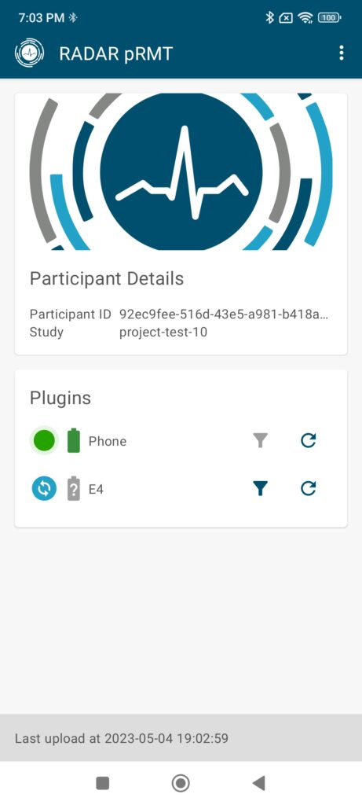

The RADAR-base Passive Mobile App (pRMT App) is the hub for collecting background sensor data and provides data streams from both on-phone sensors (below) and the capability to collect data from a number of wearable devices. New wearable devices can readily be connected to the passive app as plugins using a vendor SDK.

-   Collect data from native phone sensors and APIs
-   Plugin integration of peripheral wearable devices using Bluetooth
    -   Empatica E4, Faros
-   Easy onboarding via QR code scanning
-   Real-time streaming
-   Customizable plugins per study
-   Fault tolerance on the app

---

_This page was copied from [Passive app (pRMT)](https://radar-base.org/docs/prmt-app/) on the RADAR-base website (3 September 2026). If you change it here, change it there too._
