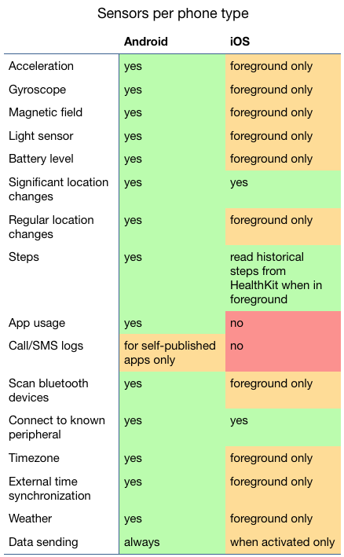

The RADAR-base Passive Mobile App is the hub for collecting background sensor data and provides data streams from both on-phone sensors (below) and the capability to collect data from a number of wearable devices. New wearable devices can readily be connected to the passive app as plugins using a vendor SDK.

## RADAR-base Support for Android

The boxes below contain descriptions of available passive phone sensors. Besides the phone sensors we also support the data sensors of an increasing list of devices. For the current overview, please see the [Supported Devices](/client/supported-devices).

The schemas with all data fields retrieved from the smartphone sensors can be found here: [https://github.com/RADAR-CNS/RADAR-Schemas/tree/master/commons/passive/phone](https://github.com/RADAR-CNS/RADAR-Schemas/tree/master/commons/passive/phone)

Default sampling rates [https://github.com/RADAR-base/radar-commons-android/tree/master/plugins/radar-android-phone](https://github.com/RADAR-base/radar-commons-android/tree/master/plugins/radar-android-phone)

### Relative location

Collects the relative degrees of latitude and longitude data from GPS and/or the Android Network Location Provider (using cell tower and WiFi signals). To ensure participants privacy, the absolute location is converted to a location relative to an unspecified reference offset. No absolute location data is streamed to or stored on the server. Besides the coordinates, the module also collects altitude (relative), speed, bearing and the accuracy of the location.

Location data can be used to derive information about the mobility of participants and determine commonly visited locations.

_Avro schema:_ [phone\_relative\_location](https://github.com/RADAR-base/RADAR-Schemas/tree/master/commons/passive/phone/phone_relative_location.avsc)

#### Note on relative coordinates

A problem caused by randomly shifting coordinates to a different origin, is that distances between these coordinates cannot be calculated accurately. A degree travelled at the equator is a different distance than in the Arctic. The longitude is made relative to the first longitude reported for that participant. The latitude however, is only shifted by a random number of degrees between -4 and 4. This means that for a received relative location, the actual location will be within a 8 degree latitude band around the earth. The 8 degree latitude band corresponds to a UTM latitude band, which allows for a good approximation of the actual distance. See for more information: [https://en.wikipedia.org/wiki/Universal\_Transverse\_Mercator\_coordinate\_system](https://en.wikipedia.org/wiki/Universal_Transverse_Mercator_coordinate_system)

### Acceleration

Collects the raw acceleration values from the 3-axis accelerometer with the gravitational constant (g ≈ 9.81m/s) as unit. By default, the values are collected in roughly 200 millisecond intervals. The values include the gravitational acceleration. For a device at rest, the magnitude of acceleration is therefore approximately 1g. The acceleration can be used to assess general activity as well as analyse movement in more detail, e.g. the gait of participants.

_Avro schema:_ [phone\_acceleration](https://github.com/RADAR-base/RADAR-Schemas/tree/master/commons/passive/phone/phone_acceleration.avsc)

### Gyration

Collects the raw gyration values from the 3-axis gyroscope in radians per second (rad/s).  By default, the values are collected in 200 millisecond intervals. The gyration reports the rotation of the device over one of the three axes. The gyration can be used to analyse movement, e.g. the gait of participants.

_Avro schema:_ [phone\_gyroscope](https://github.com/RADAR-base/RADAR-Schemas/tree/master/commons/passive/phone/phone_gyroscope.avsc)

### Magnetic Field

Collects the raw magnetic field from the 3-axis magnetometer. By default, the values are collected in 200 millisecond intervals and have micro Tesla (µT) as unit. Without the presence of other magnets, the sensor measures the earth magnetic field. This can be used, together with the acceleration and gyration, to determine the position of the device.

_Avro schema:_ [phone\_magnetic\_field](https://github.com/RADAR-base/RADAR-Schemas/tree/master/commons/passive/phone/phone_magnetic_field.avsc)

The acceleration, gyration and magnetic field sensors follow the Android sensor coordinate system: [https://developer.android.com/guide/topics/sensors/sensors\_overview.html#sensors-coords](https://developer.android.com/guide/topics/sensors/sensors_overview.html#sensors-coords)

### Step count

Reports the number of steps taken since the previous step count record. In most cases the number is one, which means that every single step will produce a record. The phone derives the step count either from the accelerometer and magnetometer or gyroscope, depending on the availability. The step count can be used as a generic proxy for activity and to approximate distance walked.

_Avro schema:_ [phone\_step\_count](https://github.com/RADAR-base/RADAR-Schemas/tree/master/commons/passive/phone/phone_step_count.avsc)

### Light

Reports the light intensity from the light sensor in luminous flux per unit area (illuminance, lx). The illuminance is captured if the value changes. This means that when e.g. the light sensor is covered, no values are reported after an initial 0 lx. The light intensity can be used to determine whether the participant is inside in a dark room (e.g. bedroom), illuminated room or outside.

_Avro schema:_ [phone\_light](https://github.com/RADAR-base/RADAR-Schemas/tree/master/commons/passive/phone/phone_light.avsc)

### Bluetooth devices

Collects the number of paired and nearby Bluetooth devices. By default, the data is collected every hour. As most phones have Bluetooth, the number of nearby Bluetooth is a proxy for the number of people are in the vicinity of the participant. This should be used with care however, because also most other, non-person bound, devices have Bluetooth capabilities. For instance nearby printers and laptops are also counted.

_Avro schema:_ [phone_bluetooth_devices](https://github.com/RADAR-base/RADAR-Schemas/tree/master/commons/passive/phone/phone_bluetooth_devices.avsc)

### Activity recognition events

The app subscribes to Android’s Activity Recognition API, which emits events when the operating system detects a change in the participant’s activity. Each event includes a classification and a confidence level. Activity classifications include walking, running, on a bicycle, in a vehicle, on foot, tilting, and still. No raw motion or sensor data is recorded by this plug-in. Only the high-level activity classifications produced by the operating system are recorded, in real time as the OS detects transitions.

_Avro schema_: [google_activity_transition_event](https://github.com/RADAR-base/RADAR-Schemas/blob/9e7e60d5bacefe8be2bc76eb9b9d7d4546cda21b/commons/passive/google/google_activity_transition_event.avsc)

### Sleep events

The app subscribes to Android’s Sleep API, which provides on-device sleep classification derived from the phone’s own sensors. The plug-in receives two kinds of event: sleep classifications, which indicate whether the participant is asleep, awake, or in a particular sleep state, and segment events that mark the start and end of a sleep period. No raw sensor data is recorded by this plug-in. Only the classifications produced by the operating system are recorded, delivered as the OS detects changes.

_Avro schema_: [google_sleep_segment_event](https://github.com/RADAR-base/RADAR-Schemas/blob/9e7e60d5bacefe8be2bc76eb9b9d7d4546cda21b/commons/passive/google/google_sleep_segment_event.avsc) and [google_sleep_classification_event](https://github.com/RADAR-base/RADAR-Schemas/blob/9e7e60d5bacefe8be2bc76eb9b9d7d4546cda21b/commons/passive/google/google_sleep_classify_event.avsc)

### Interaction state

Collects the phone interaction state from the Android system. Every phone lock (standby), unlock and shutdown is recorded from respectively the ACTION\_SCREEN\_OFF, ACTION\_USER\_PRESENT and ACTION\_SHUTDOWN intents broadcasted by the system. Also the phone startup is collected by listening for the first action since a shutdown.

This data can be used to retrieve the total time the phone was used per time period. In conjunction with the application usage, this gives a complete view of the participants phone use.

_Avro schema:_ [phone\_user\_interaction](https://github.com/RADAR-base/RADAR-Schemas/tree/master/commons/passive/phone/phone_user_interaction.avsc)

### Application usage

Collects opening and closing of installed phone applications. To be more specific, this module listens for the ‘move to foreground’ and ‘move to background’ events for every application. For every event, the package name of the app and event type is registered. The app category, as given by the Google Play Store, is added to the record in the Kafka backend. In addition, the package name can be removed to protect the privacy of the participant.

The application usage events give insight in the app use of the participant. Metrics like number of apps used and total app usage time per category can be derived from this data.

_Avro schema:_ [phone\_usage\_event](https://github.com/RADAR-base/RADAR-Schemas/tree/master/commons/passive/phone/phone_usage_event.avsc)

### Call log

Collects ingoing and outgoing calls. The duration of each call, the phone number of the caller and whether the caller is a contact is captured. The phone numbers of callers are hashed, such that the actual numbers are concealed. Also the actual call audio is not stored.

The call log provides a measure for communication and social interaction. Metrics like the number of different contacted persons can be derived.

_Avro schema:_ [phone\_call](https://github.com/RADAR-base/RADAR-Schemas/tree/master/commons/passive/phone/phone_call.avsc)

### SMS log

Collects received and send text messages. The length of the message, the phone number of the sender/receiver and whether the sender/receiver is a contact is captured. In addition, the number of unread messages is, by default, collected every day. The phone numbers of callers are hashed, such that the actual numbers are concealed. Also the actual content of the message is not stored.

Similarly to the call log, the SMS log provides a measure for communication and social interaction. Note that the SMS log does not include messages send via other messaging services.

_Avro schema:_ [phone\_sms](https://github.com/RADAR-base/RADAR-Schemas/tree/master/commons/passive/phone/phone_sms.avsc), [phone\_sms\_unread](https://github.com/RADAR-base/RADAR-Schemas/tree/master/commons/passive/phone/phone_sms_unread.avsc)

### Contact list

Collects the current number of contacts in the phone’s contact list and the changes since the previous check. By default, the data is collected every day. This only includes the phone’s native contact application.

Tracking the number of contacts can be used to monitor new social interactions a participant might have had.

_Avro schema:_ [phone\_contact\_list](https://github.com/RADAR-base/RADAR-Schemas/tree/master/commons/passive/phone/phone_contact_list.avsc)

### Battery level

Collects the phone battery level and charging status upon change. It can for instance be used to help determine when the participant is traveling and when he/she is home, depending on the charging status. The battery level is only reported when it changes.

_Avro schema:_ [phone\_battery\_level](https://github.com/RADAR-base/RADAR-Schemas/tree/master/commons/passive/phone/phone_battery_level.avsc)

### Local Weather

Plug-in ‘radar-android-weather’.

Reports the current local weather conditions. By default, the data is collected every 3 hours from the OpenWeatherMap API. The phone GPS or network coordinates are used to request data for the location. The following weather information is captured:

• ambient temperature in degrees Celsius (C)

• atmospheric pressure in hectoPascal (hPa)

• humidity in percentage (%)

• cloudiness in percentage (%)

• precipitation in millimeter rain/snow (mm)

• condition type

• sunrise and sunset in minutes after midnight (to calculate total minutes of daylight)

The weather conditions can be used to relate participant activity and/or mood to outside conditions.

Note: this data is sensitive, as it can be used in combination with e.g. relative location to improve the approximation of the participants location.

_Avro schema:_ [local\_weather](https://github.com/RADAR-CNS/RADAR-Schemas/tree/master/commons/passive/weather/local_weather.avsc)

Information on the pRMT application and connected server. Used for monitoring the connection.

## RADAR-base Support for iOS

Separate **Android** and **iOS** versions of the Passive Data Collection app have been developed as part of RADAR-base, however, there are substantial differences in the mobile sensors available on iOS, in particular, these may be more sparse in iOS due to lack of background collection capabilities:

---

_This page was copied from [Phone data sensors](https://radar-base.org/docs/4048-2/) on the RADAR-base website (3 September 2026). If you change it here, change it there too._
