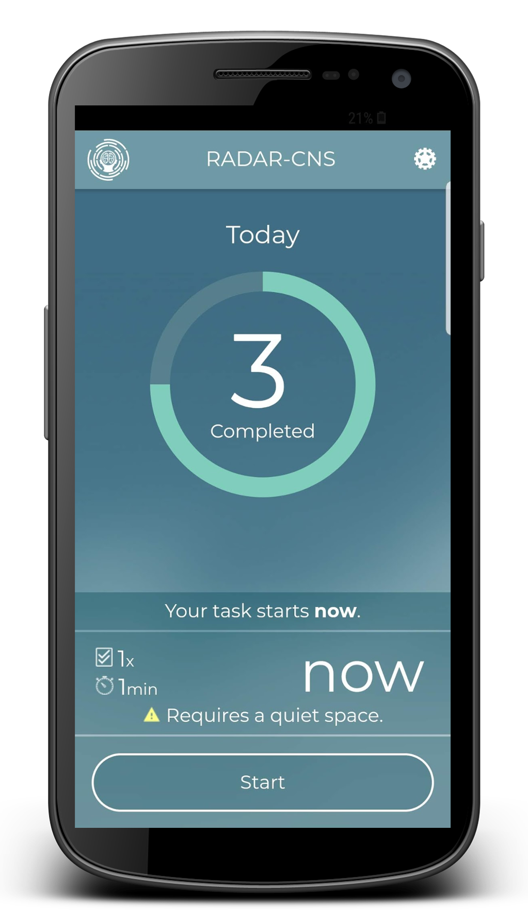
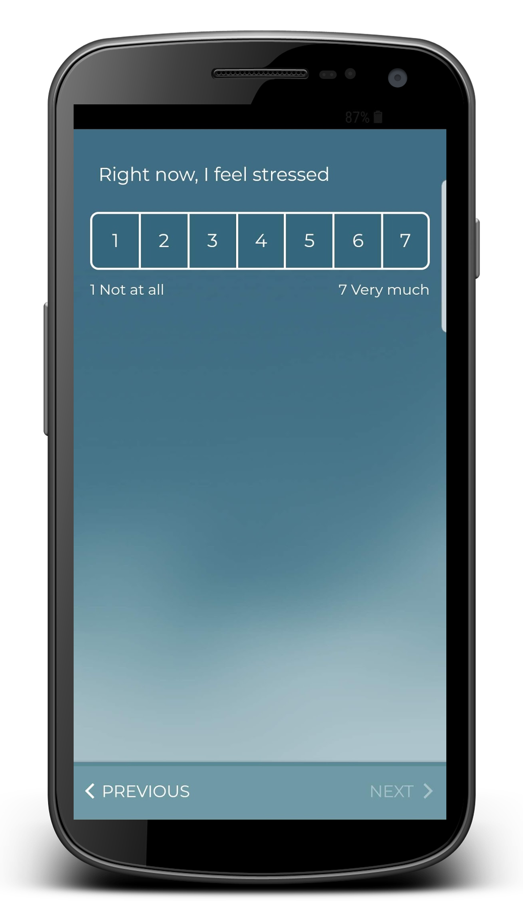

RADAR-base includes a fully configurable questionnaire mobile application for the delivery of active tasks:

-   Support on both [**Android**](https://play.google.com/store/apps/details?id=org.phidatalab.radar_armt&hl=en) (minimum version Android 6) and [**iOS**](https://apps.apple.com/gb/app/radar-active-rmt/id1483953055) (minimum version iOS 11)
-   Simple configuration of new questionnaires
-   Firebase Cloud Messaging remote notifications to inform when to complete questionnaires and tasks
-   Simple configurable schedules for questionnaire regimens
-   Spoken questionnaire audio sampling capture

---

_This page was copied from [Questionnaire app (aRMT)](https://radar-base.org/docs/questionnaire-app/) on the RADAR-base website (3 September 2026). If you change it here, change it there too._
