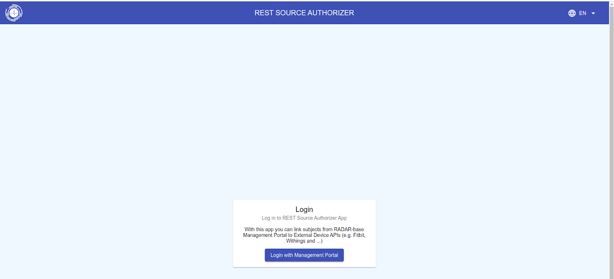
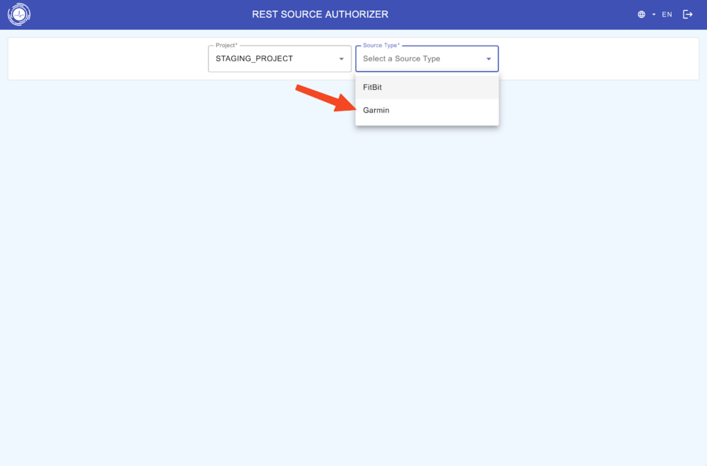
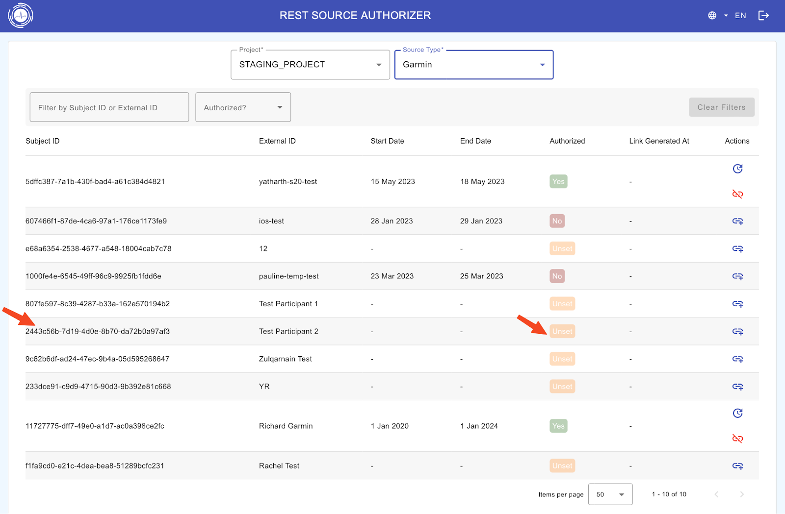
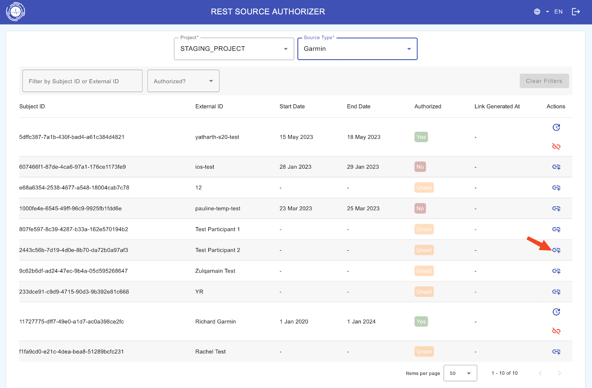
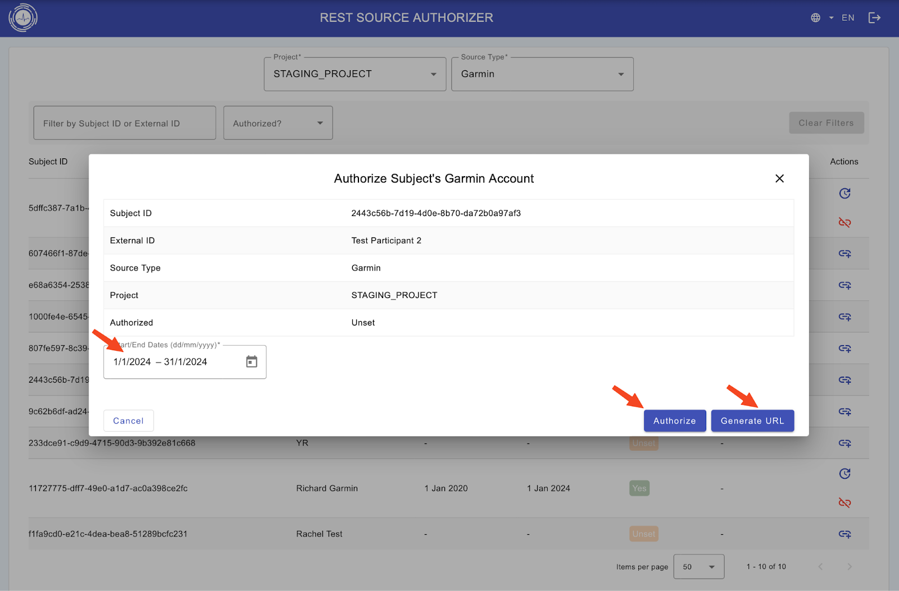
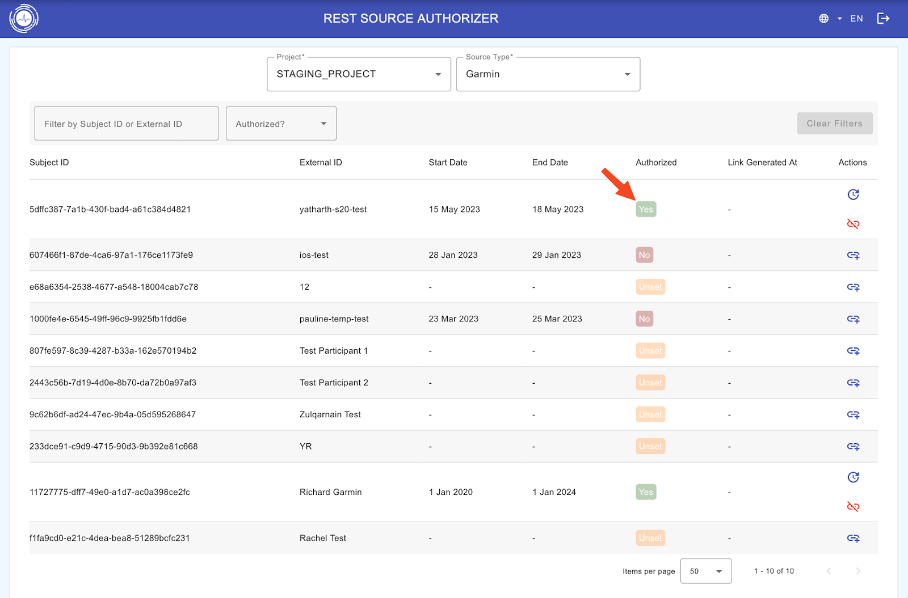
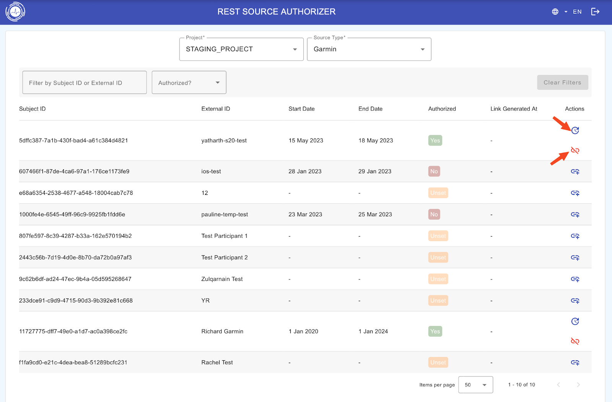

## REST-Authorizer authentication procedure (for wearables like Oura, Fitbit and Garmin)

The RADAR-REST-Source-Auth is an application to get authorization from users to access their data through 3rd party APIs (e.g. Oura, FitBit, Garmin). Mainly supports OAuth2 Authorization code flow to request authorization and processes the returned authorization code to add new entries of users for data collection. It creates new users and adds properties compatible with and required by the [RADAR REST and Fitbit connectors](https://github.com/RADAR-base/RADAR-REST-Connector).

```
Login to https://<radar-base-deployment-url>/rest-sources/authorizer/login
```

Steps –

1\. Create Subject On Management Portal (or via Redcap should be done automatically)

2\. Set up the wearable (Fitbit/Garmin/Oura)  email and password (no need if the participant is doing this themselves)

3\. Go to the authoriser, log in with your management portal credentials and Select your project.



4\. Select the wearable source type



5\. Check the subject Id and external ID (e.g. redcap Id) that you want to pair the Device for. Check the Authorized Status is “Unset” in yellow.



6\. Then select the Attach+ icon at the right end of the subject row under the Actions column.



7\. Input the start and end dates

8\. Now, you can either Authorize yourself if you have the participant’s Wearable account login credentials, or you can Generate a URL to send to the participant to log in themselves.



9\. This will open the wearable device vendor-specific account login screen. Enter the participant’s wearable device account login credentials. Select all the scopes required and grant the permissions, after which you will be redirected back to the authorizer and the Authorized Status for the subject will now be “Yes” in green.



10\. After this, you can also de-authorize the subject with the red detach button (for example, if they change their wearable account or leave the study), or you can reset the user (for example, to re-pull all the data between particular dates or to change the start and end dates) with the blue reset button under Actions.



---

_This page was copied from [RADAR-Rest-Source-Auth](https://radar-base.org/docs/radar-rest-source-auth/) on the RADAR-base website (3 September 2026). If you change it here, change it there too._
