Devices integrated into the RADAR-base platform. See [Table of Data Types](https://radar-base.github.io/RADAR-Schemas/) and [RADAR-base schemas](https://github.com/RADAR-base/RADAR-Schemas/tree/master/commons) for more comprehensive details of data types collected.

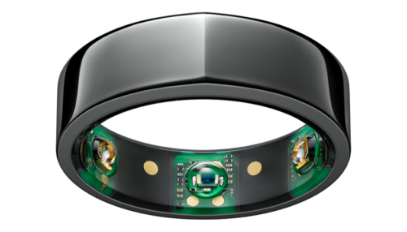

## Oura Ring Devices

Finger Worn

Activity\
Heart rate\
Sleep\
Stress tracking\
Readiness Score\
SpO2\
Temperature

RADAR-base Integration: via REST-API Connector

[RADAR-base Oura Schemas](https://github.com/RADAR-base/RADAR-Schemas/tree/master/commons/connector/oura)

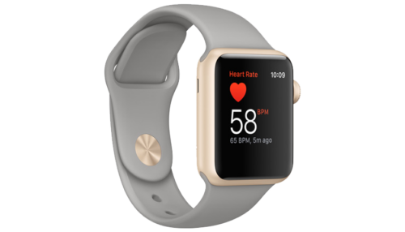

## Apple Watch Devices (and iPhones)

Wrist Worn

Activity\
Heart rate\
Sleep\
HRV\
SpO2\
Temperature

RADAR-base Integration: via Active App HealthKit Plugin

[RADAR-base Healthkit Spec.](https://github.com/RADAR-base/RADAR-Schemas/blob/master/specifications/active/aRMT-healthkit-1.0.0.yml)

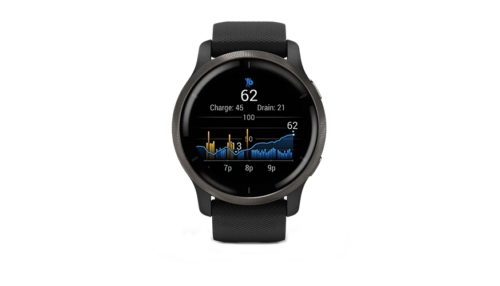

## Garmin Devices

Wrist Worn

Activity\
Heart rate\
Sleep\
Stress tracking\
Vo2 max\
Body Battery\
SpO2 (night time and on-demand)\
Respiration Rate

RADAR-base Integration: via REST-API Connector

[RADAR-base Garmin Schemas](https://github.com/RADAR-base/RADAR-Schemas/tree/master/commons/push/garmin)

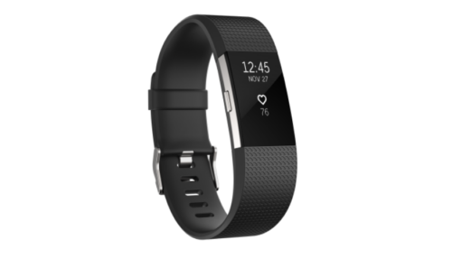

## FitBit Devices

Wrist worn

Steps\
Heart rate, HRV (PPG)\
Sleep\
Temperature\
Irregular Heart Rate

RADAR-base Integration: via REST-API Connector

[RADAR-base FitBit Schemas](https://github.com/RADAR-base/RADAR-Schemas/tree/master/commons/connector/fitbit)

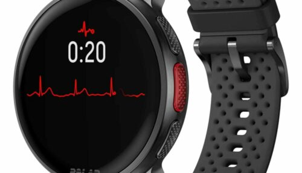

## Polar Vantage V3

**Polar Vantage V3**

Wrist worn

Raw acceleration\
Steps\
Heart rate (PPG)\
PP-interval in ms\
Wrist ECG\
Blood volume pulse (PPG)\
Sleep stages\
Temperature

RADAR-base Integration: via Passive App (pRMT)

[RADAR-base Polar Schemas](https://github.com/RADAR-base/RADAR-Schemas/tree/master/commons/passive/polar)

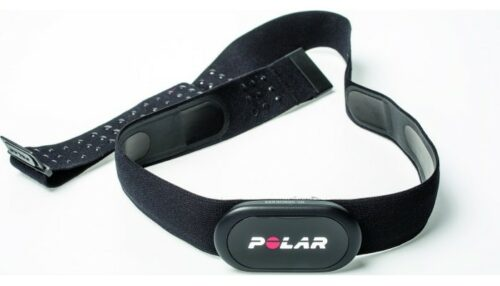

## Polar H10 Heart Rate Sensor

**Polar H10 Sensor**

Chest worn

Raw acceleration\
Heart rate (PPG)\
RR-interval in ms

RADAR-base Integration: via Passive App (pRMT)

[RADAR-base Polar Schemas](https://github.com/RADAR-base/RADAR-Schemas/tree/master/commons/passive/polar)

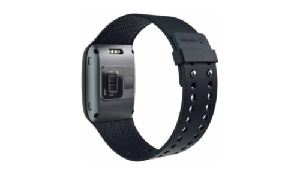

## Empatica E4

**Empatica E4**

Wrist worn

Raw acceleration\
Heart rate (PPG)\
Blood volume pulse (PPG)\
Electro Dermal Activity\
Temperature

RADAR-base Integration: via Passive App (pRMT)

[RADAR-base E4 Schemas](https://github.com/RADAR-base/RADAR-Schemas/tree/master/commons/passive/empatica)

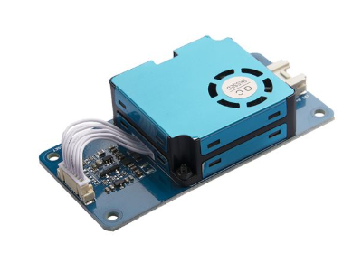

## IoT Sensors

Static environments

Supports various IoT sensing devices including support for common I/O protocols such as GPIO, I2C and Serial. It currently supports temperature, humidity, motion, light, air quality, and gas sensors. Easy to extend and support new sensor types.

RADAR-base Integration: via RADAR-IoT Module

[RADAR-base IoT Schemas](https://github.com/RADAR-base/RADAR-Schemas/tree/sensors/commons/iot/sensor)

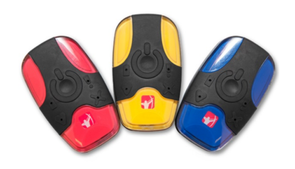

## Faros

Chest/pocket

Raw acceleration\
Heart rate (ECG raw waveform)\
Temperature

RADAR-base Integration: via Passive App (pRMT)\
Notice: Deprecated Device

[RADAR-base Faros Schemas](https://github.com/RADAR-base/RADAR-Schemas/tree/master/commons/passive/bittium)

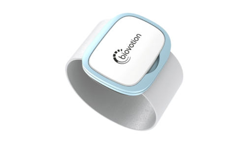

## Biovotion

Upperarm

Raw acceleration\
Heart rate (PPG)\
Heart rate variability (PPG)\
Blood volume pulse (PPG)\
Electro Dermal Activity (GSR)\
Temperature\
Respiration rate\
Oxygen saturation

RADAR-base Integration: via Passive App (pRMT)\
Notice: Deprecated Device

[RADAR-base Biovotion Schemas](https://github.com/RADAR-base/RADAR-Schemas/tree/master/commons/passive/biovotion)

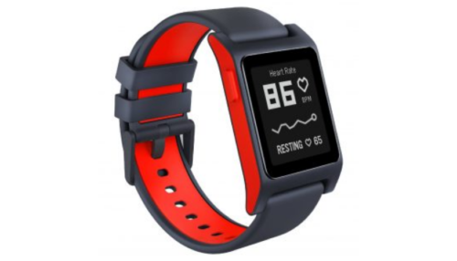

## Pebble 2

Wrist worn

Raw acceleration\
Heart rate (PPG)

RADAR-base Integration: via Passive App (pRMT)\
Notice: Deprecated Device

[RADAR-base Pebble Schemas](https://github.com/RADAR-base/RADAR-Schemas/tree/master/commons/passive/pebble)

---

_This page was copied from [Supported devices](https://radar-base.org/docs/supported-devices/) on the RADAR-base website (3 September 2026). If you change it here, change it there too._
