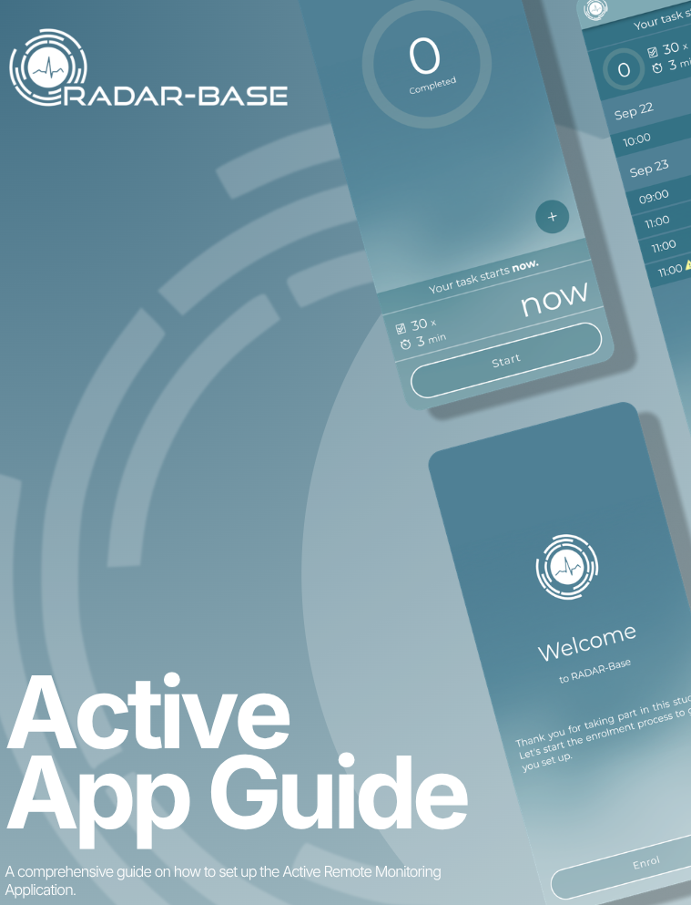
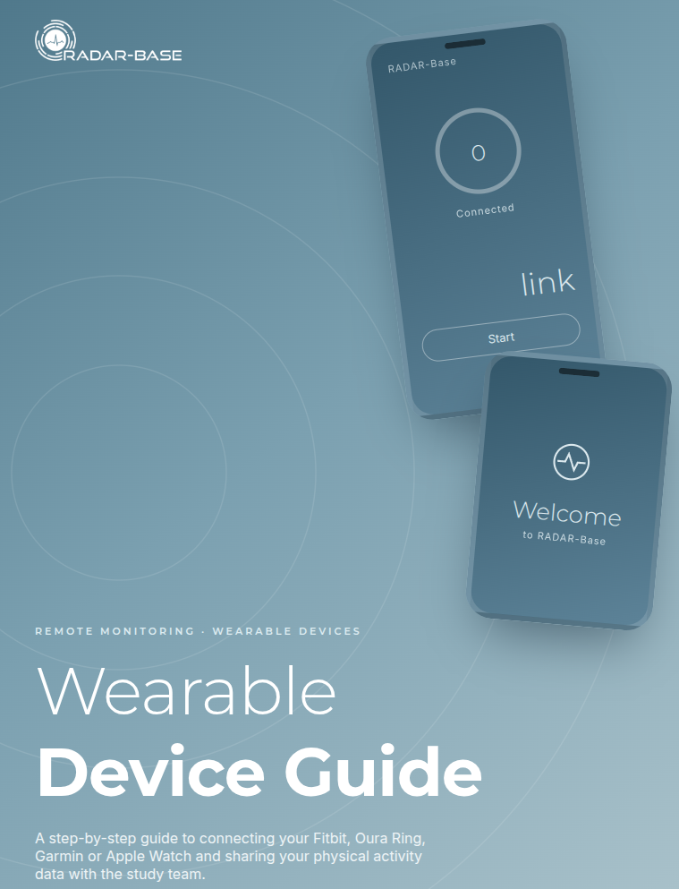

# Participant documentation

Graphical user guide documents for RADAR-base, written for the people taking part in a study.
Each guide is a Canva design, embedded here and readable full screen or downloadable from
Canva itself.

**[Active app user guide](./active-app-user-guide.md)** — getting started with the active
(questionnaire) app.

**[Wearable user guide](./wearable-user-guides.md)** — getting started with the wearable
device.

For the apps and devices themselves, see [Client documentation](/client/).

:::note Copied from the RADAR-base website
These guides were copied from
[User guide documents](https://radar-base.org/docs/user-guide-documents/) on the RADAR-base
website (3 September 2026). If you change them here, change them there too.
:::
