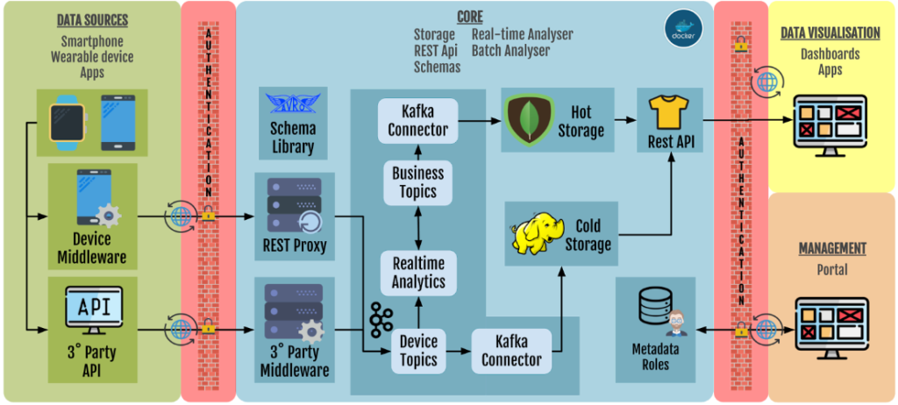

## Insight of RADAR-base platform

RADAR-Base is an open source data collection and management platform for remote assessment of diseases using various wearable devices and mobile application technologies.

### Concepts behind the RADAR-base platform architecture

The RADAR-base platform architecture was built with extensibility, flexibility and scalability in mind. Hence, the platform is designed using **plugin-based architecture** which allows various data ingestion, validation, authorization and access methods can be used. The architecture of RADAR-base makes great use of **[Apache Kafka](https://kafka.apache.org/)** and the **[Confluent platform](https://www.confluent.io/)**, a state of the art technology for distributed real time streaming. **Apache Kafka** is a novel appropriate for building real-time streaming/transforming data pipelines that reliably move data between systems at scale.

RADAR-base is built on top of the concept of **Kafka Connectors** introduced by the Confluent platform. Kafka Connectors are components built using Kafka connect APIs, an interface that simplifies and automates the integration of a new data sources or data consumers to a Kafka cluster. Kafka connectors can be categorized into **Source connectors** (to ingest data into Kafka cluster) and **Sink connectors** (to consume data from Kafka cluster). The diagram below depicts the high level architecture of data collection and management of RADAR-base platform.

### High-level Architecture

## Data Ingestion

### Device Connector Plugin Middle-ware

RADAR-base platform provides a [middle-ware](https://github.com/RADAR-CNS/RADAR-Commons-Android) that **can be extended to integrate various data-sources**. Currently, platform provides stable support for Android OS and recently started investigating to extend the support for iOS. It provides an abstract API layer, that could be easily extended to send device specific data. This abstract layer can handle authorization, encode data using Avro schemas, send data to Kafka topics using HTTPS requests. Extending this component eliminates the difficulties in implementing security, Kafka related functionalities for each devices and encapsulates platform specific implementations.

### Device Connector Plugins

A device-specific “**device connector plugin app**” can be easily implemented for every device with an Android SDK and could stream data in real-time. By extending the API layer provided by the device connector plugin provided above, sensor data collected from each device and streamed to RADAR-base back-end. Every record of sensor data is converted to Kafka messages and published to specific Kafka topics.

These are plug-in based applications that could be easily added or removed from the final [passive data collection app](https://github.com/RADAR-base/radar-prmt-android). Some of the plugin applications that are already implement are given below:

-   [Pebble](https://github.com/RADAR-CNS/RADAR-Android-Pebble)
-   [Empatica E4](https://github.com/RADAR-CNS/RADAR-Android-Empatica)
-   [Faros](https://github.com/RADAR-base/radar-android-faros)
-   [Biovotion](https://github.com/RADAR-CNS/RADAR-Android-Biovotion)
-   [Android mobile phone sensors](https://github.com/RADAR-CNS/RADAR-Android-Phone)

### REST Source Connector

For the devices, which do not have an SDK to send data through Bluetooth or directly send data to their data warehouses and provide APIs to access data from their services, a [REST source connector](https://github.com/RADAR-base/RADAR-REST-Connector) is provided. It receives data from provided APIs and sends them as Kafka messages in relevant Avro formats. It is a Kafka source connector that extends the kafka-connect API.

## Data Processing

### Kafka cluster

[Apache Kafka](https://kafka.apache.org/) is a distributed **publish-subscribe** based message queuing system. A **publisher** can produce messages to a specific topic. A **subscriber** who listens to a topic can consume messages published to that topic. Kafka keeps track of each message using an offset. Kafka also supports distributed partitions as an immutable commit log of messages offsets with the guarantee of emitted order preservation. A **Kafka cluster** can contain multiple Kafka servers and need to be coordinated by **Zookeeper,** which is a distributed resource coordinator. Kafka broker setup with integrated with Zookeeper, schema-registry, and REST-proxy are supported out of the box by the Confluent platform.

### Schema Registry

Schema registry is a component provided by the Confluent platform, to manage [Avro schemas](https://avro.apache.org/). It offers functionalities for storing a versioned history of schemas, with multiple compatibility settings and managing the evolution of schemas. It provides a RESTful interface to store and retrieve schemas.

### Kafka Rest Proxy

The **Kafka-REST-proxy** is a RESTFul Kafka producer provided by the Confluent platform. It can produce Kafka messages with/without corresponding Avro schemas and publish them using HTTP requests. It provides the interoperability to support client applications with various programming languages and eliminates Kafka specific implementation complexities. Multiple deployments of Kafka-REST-proxy allow easy load balancing on larger-scale deployment of the middle-ware.

### Aggregating Streams and Monitor

[RADAR-backend](https://github.com/RADAR-CNS/RADAR-Backend) implements [Kafka Streams](https://kafka.apache.org/documentation/streams/), to **compute aggregated values** of published data based on various time windows and **to monitor data quality and compliance**. The aggregated values are stored on separate topics and consumed by a sink-connector. The monitors are used to validate data quality and compliance and to provide email alerts for early interventions. For example, a battery level monitor is provided, which alerts the user/researcher by sending an email notification when battery level is found low according to given criteria.

**Note:** This component runs multiple Kafka Streams for real-time computations which uses high computing power. If real-time monitoring and visualization are not compulsory requirements we advise to turn these serves off.

## Data Storage

### HDFS Sink Connector

To support offline retrospective analysis, a [HDFS Sink connector](https://github.com/RADAR-CNS/RADAR-HDFS-Sink-Connector) is provided, which is called the **“cold storage”**. It consumes all the data from Kafka topics and writes them to HDFS filesystem. The HDFS sink connector is an extension of Kafka-hdfs-connector. It can be configured to consume various topics and store them in different locations in HDFS.

### MongoDB Sink Connector

A [MongoDB Sick Connector](https://github.com/RADAR-CNS/RADAR-MongoDB-Sink-Connector) is created to provide near real-time overview of the data. It consumes aggregated-data computed and stored by Kafka-Streams mentioned in [RADAR-backend,](https://github.com/RADAR-CNS/RADAR-Backend) and writes them as MongoDB documents. It is called as the **“hot storage”** of the RADAR-base platform. These near real-time data can be accessed either directly via querying the database or querying using integrated RESTful API.

## Data Extraction and Visualization

### REST-API Service

[RADAR-REST-API](https://github.com/RADAR-CNS/RADAR-RestApi) component of RADAR-base, provides interfaces to access the aggregated data stored in MongoDB. It is also integrated with the study management system of the platform and handles authorization. The REST-API component include APIs to access metadata of the studies, participants and data sources in addition providing access to aggregated data.

### Dashboard

The [dashboard](https://github.com/RADAR-CNS/RADAR-Dashboard) component provides user interfaces to visualize near real-time sensor data and the platform status. It uses the [REST-API](https://github.com/RADAR-CNS/RADAR-RestApi) to access the data stored in the platform. Various visualization widgets are implemented to visualize sensor data including charts, graphs etc.

### HDFS Data Extractor

Data streamed to HDFS using the [RADAR HDFS sink connector](https://github.com/RADAR-CNS/RADAR-HDFS-Sink-Connector) is stored as files based on sensor(topic) only. This [utility package](https://github.com/RADAR-CNS/Restructure-HDFS-topic) can transform that output to a local directory structure as follows: **projectId/userId/topic/date\_hour.csv**. Currently, it can export avro data into avro, JSON and CSV formats.

## Study Management and Security

### Management Portal

RADAR-base provides a **centralized study management system** called [Management Portal](https://github.com/RADAR-base/ManagementPortal) to manage multiple **studies, users and their roles** to guarantee security and privacy. This web application is the main user interface for planning and managing multiple studies, enrolling participants and managing the association of participants with corresponding data sources (devices and apps). This system controls the **authentication and authorization of data** operations and **de-Identification** of all the data identifiers.

### Gateway

[RADAR-Gateway](https://github.com/RADAR-CNS/RADAR-Gateway) is a component which behaves as an entry-point to RADAR-base platform back-end. It **validates the user identity and access**, (i.e. authentication and authorization), schematic validation, load-balancing of the Kafka-REST-proxy etc. All of the data sent to the RADAR-base platform is verified using the RADAR-gateway before the data is published on Kafka cluster.

Read the step-by-step guidelines on [How to Install RADAR-base](https://radar-base.org/docs/installation/).

---

_This page was copied from [Concepts and components of RADAR-base](https://radar-base.org/docs/concepts-and-components-of-radar-base/) on the RADAR-base website (3 September 2026). If you change it here, change it there too._
